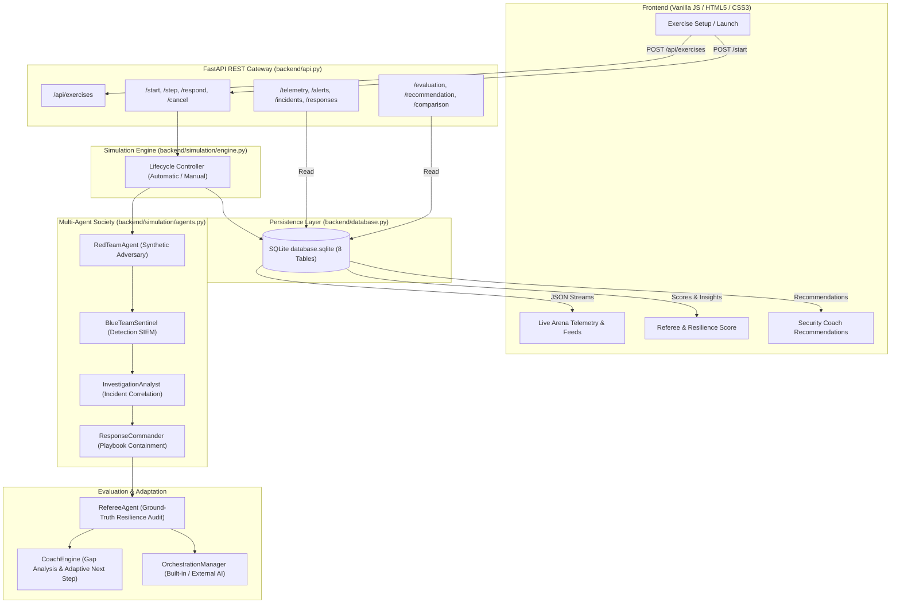
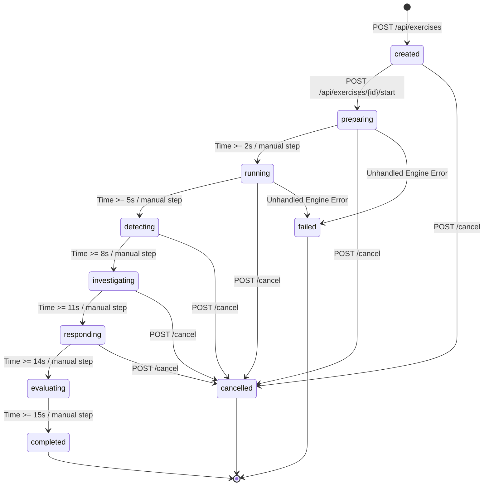
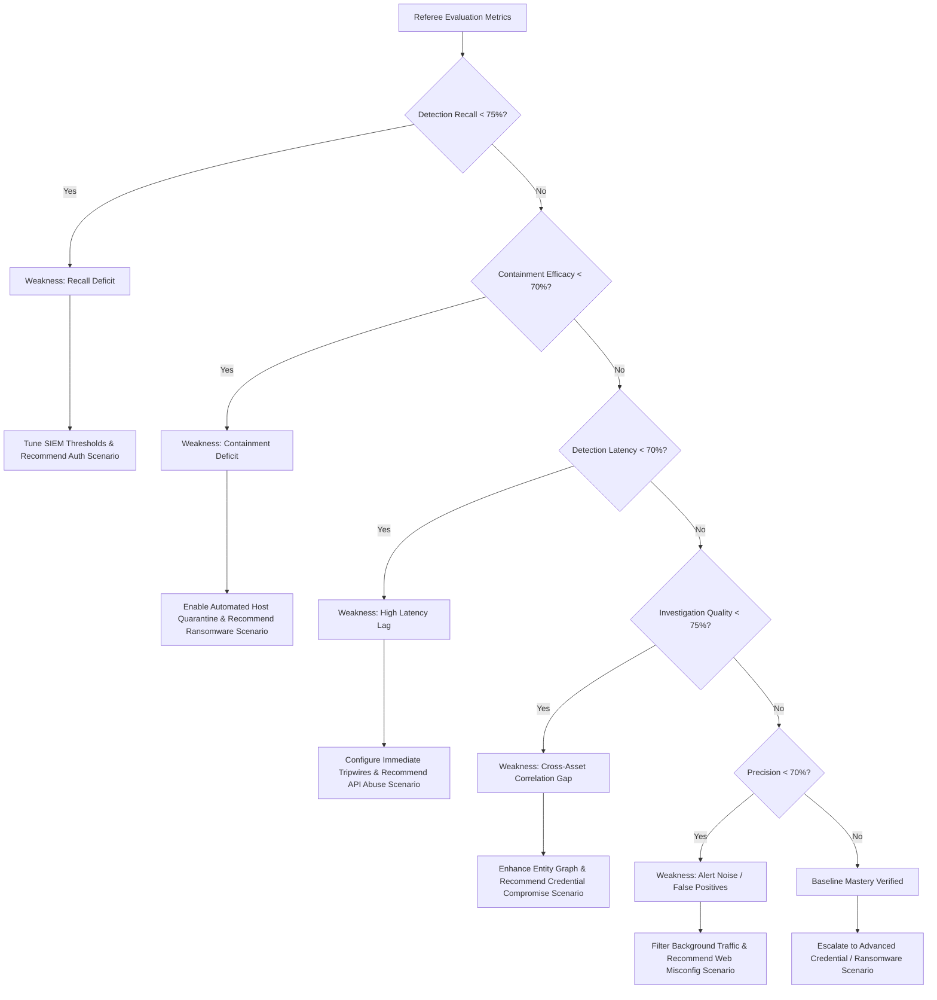

# HavenSec Arena — Comprehensive Backend Walkthrough & Architecture Reference

**Document Version:** 2.0.0  
**Project:** HavenSec Arena — AI-Powered Multi-Agent Red Team and Blue Team Cyber-Resilience Simulation Platform  
**Academic Context:** Tapi Diploma Engineering College | Department of Information Technology | Semester 5 — Minor Project  
**Student Author:** Heet Kalthiya  
**Target Audience:** College External Viva Examiners, Project Reviewers, and Software Engineers  

---

## 1. Executive Architecture Overview

HavenSec Arena is a multi-agent cybersecurity simulation and cyber-resilience scoring platform. It models adversarial tactics and security operations center (SOC) defensive workflows in a controlled, 100% synthetic environment.

---

## 2. End-to-End Walkthrough: What Happens When User Clicks "Launch Simulation"

Here is the exact step-by-step trace from UI click to evaluation completion:

### Step 1: Frontend Form Submission (`frontend/app.js`)
1. In the **Exercise Setup** view, the user selects:
   - **Scenario**: e.g., `scenario-suspicious-auth`
   - **Difficulty**: `intermediate`
   - **Simulation Mode**: `automatic` (autonomous loop) or `manual` (human-in-the-loop)
   - **Target Asset**: `AUTH-01`
   - **Seed**: `42`
2. The user clicks **Launch Simulation**.
3. JavaScript event listener (`exercise-form` submit) executes:
   - Issues an HTTP POST request to `/api/exercises` with JSON payload matching `ExerciseConfig`.
   - On success (`200 OK`), extracts `exercise.id` and immediately calls `startSimulation(exercise.id, mode)`.
   - Calls `POST /api/exercises/{id}/start` to kick off execution.
   - Clears existing DOM feeds and switches UI tab to the **Live Arena** (`view-arena`).
   - Starts an asynchronous polling interval (`pollLiveArenaState`) running every 1,000 ms.

### Step 2: API Validation & Creation (`backend/api.py`)
1. Request hits endpoint `POST /api/exercises`.
2. Pydantic validates incoming payload against `ExerciseConfig` model:
   - Validates `scenarioId` exists in `SCENARIOS` library.
   - Sets defaults for optional fields (`seed=42`, `difficulty="intermediate"`).
3. Generates unique identifier: `ex-{uuid.uuid4().hex[:8]}` (e.g., `ex-3f9a12c4`).
4. Determines exercise sequence number via `len(list_exercises()) + 1`.
5. Persists new record to SQLite table `exercises` with `status="created"` and `current_phase="created"`.
6. Returns HTTP 200 with the serialized exercise entity.

### Step 3: Exercise Startup (`backend/api.py` & `backend/simulation/engine.py`)
1. Frontend calls `POST /api/exercises/{exercise_id}/start`.
2. API validates that the exercise exists and is in a valid starting state (`created`).
3. Updates exercise status to `running`, sets `currentPhase="preparing"`, and records `startedAt` ISO timestamp.
4. Calls `start_simulation(exercise_id)` in `engine.py`:
   - **If mode is `automatic`**: Spawns a background `asyncio.Task` executing `run_simulation_loop(exercise_id)`. The task reference is stored in the global dictionary `active_simulation_tasks[exercise_id]`.
   - **If mode is `manual`**: Initializes an active manual session object in `active_manual_sessions[exercise_id]` with instantiated agents and returns immediately, awaiting manual `/step` triggers.

---

## 3. Deep Dive into Backend Subsystems

### 3.1 Exercise Creation, Lifecycle, Cancellation, and Completion

HavenSec Arena enforces a strict finite-state machine (FSM) for exercise lifecycles:

- **Cancellation**: When `POST /api/exercises/{id}/cancel` is received:
  - If background task is active, calls `task.cancel()` and removes task from tracking.
  - Removes any active manual session from memory.
  - Updates SQLite record status to `cancelled` and phase to `cancelled`.
  - Disallows cancelling exercises that already reached a terminal state (`completed`, `cancelled`, `failed`).
- **Completion**: When simulation loop reaches elapsed limit (15s in auto mode or step 6 in manual):
  - Exercise status transitions to `completed`.
  - `endedAt` timestamp is recorded.
  - `durationSeconds` (15) is saved.

---

### 3.2 Dual Simulation Modes: Automatic vs. Manual

| Dimension | Automatic Mode (`mode: "automatic"`) | Manual Mode (`mode: "manual"`) |
|---|---|---|
| **Execution Trigger** | Asynchronous background loop (`asyncio.create_task`) | Step-by-step HTTP requests (`POST /api/exercises/{id}/step`) |
| **Pacing** | Wall-clock timer: 15 seconds real-time (or ~15ms in test fast-mode) | Operator paced: pauses at each phase until operator clicks "Step" |
| **Response Actions** | Automated Response Commander dispatches playbooks during `responding` phase | SOC operator dispatches manual containment playbooks via `POST /api/exercises/{id}/respond` |
| **Session Tracking** | Tracked in `active_simulation_tasks[exercise_id]` | Tracked in `active_manual_sessions[exercise_id]` |
| **Use Case** | Continuous integration testing, rapid automated benchmarking | Interactive college viva demonstrations, educational walk-throughs |

---

### 3.3 Scenario Definitions and Ground-Truth Objectives

All scenarios are defined in `backend/simulation/scenarios.py` with zero reliance on live internet access.
There are **6 pre-configured scenarios**:
1. `scenario-suspicious-auth`: Brute force, credential stuffing, and account takeover against `AUTH-01`.
2. `scenario-api-security`: API fuzzing, parameter tampering (IDOR), and data exfiltration against `API-01` and `DB-01`.
3. `scenario-web-misconfig`: Path traversal and debug panel discovery against `WEB-01`.
4. `scenario-credential-compromise`: Token replay, SMB lateral movement to `FILE-01`, and secrets dumping on `DB-01`.
5. `scenario-privilege-escalation`: Role query and administrative claim escalation against `AUTH-01`.
6. `scenario-ransomware-controlled`: Mass file enumeration, high-entropy file writes, and volume shadow copy deletion against `FILE-01`.

Each scenario defines **Ground-Truth Objectives (`groundTruthObjectives`)**:
- `id`: Unique objective identifier (e.g., `gt-auth-02`).
- `name`: Human-readable adversary goal.
- `phase`: The expected lifecycle phase during which the technique unfolds.
- `targetAsset`: Intended asset victim (e.g., `AUTH-01`).
- `expectedIndicator`: Specific telemetry signature (e.g., `LOGIN_FAILED`).
- `criticality`: `low`, `medium`, `high`, or `critical`.
- `mitreTactic`: Formal MITRE ATT&CK tactic category (e.g., `Credential Access`).

---

### 3.4 Multi-Agent Society Execution

#### 1. Red Team Agent (`RedTeamAgent`)
- **Role**: Synthetic Adversary.
- **Mechanism**: On each tick (`tick()`), checks elapsed time and scenario step counter.
- **Asset Targeting**: Targets the specified `targetAsset` configured for the exercise.
- **Benign Background Noise**: Every 4,000ms, injects benign HTTP requests (e.g., `/api/v1/health` with `status: 200` by `monitoring_agent`) to provide realistic noise and test Blue Team precision (avoiding false alarms).
- **Adversarial Sequence**: Generates synthetic attack telemetry matching the scenario's ground-truth kill chain. Sets `isMalicious=True` and links `groundTruthObjectiveId`.

#### 2. Blue Team Sentinel (`BlueTeamSentinel`)
- **Role**: SIEM and Detection Correlation Engine.
- **Mechanism**: Inspects telemetry stream on each tick.
- **Rule Set**:
  - `RULE-AUTH-BRUTE`: Triggers on $\ge 3$ consecutive `LOGIN_FAILED` events on an auth asset.
  - `RULE-SESSION-HIJACK`: Triggers on `SESSION_HIJACK_ATTEMPT` with geographic/token anomalies.
  - `RULE-API-ABUSE`: Triggers on `API_ANOMALY` or `PARAMETER_TAMPERING`.
  - `RULE-DATA-EXFIL`: Triggers on `DATA_EXFIL_ATTEMPT` bulk query patterns.
  - `RULE-WEB-TRAVERSAL`: Triggers on `PATH_TRAVERSAL_ATTEMPT` or `DEBUG_PROBE`.
  - `RULE-LATERAL-MOVE`: Triggers on `TOKEN_REPLAY`, `LATERAL_MOVEMENT`, or `PRIVILEGED_DUMP`.
  - `RULE-PRIV-ESC`: Triggers on `PRIVILEGE_CHANGE` role elevation events.
  - `RULE-RANSOM-ACTIVITY`: Triggers on `ENCRYPTION_INTENT` or `BACKUP_DISRUPTION_ATTEMPT`.
- **Latency Tracking**: Records `first_detection_ts` on the very first triggered alert to calculate detection latency.
- **Telemetry Mirroring**: For every alert generated, writes an `ALERT_CREATED` event back into the unified telemetry stream for full SOC visibility.

#### 3. Investigation Analyst (`InvestigationAnalyst`)
- **Role**: Incident Triage and Evidence Graph Assembler.
- **Mechanism**: Correlates individual alerts by affected `sourceAsset`.
- **Clustering**: If an alert arrives for an asset without an active incident, creates a new `Incident` record (`status="investigating"`). If an incident already exists for that asset, appends new evidence indicators to the existing record.
- **Telemetry Mirroring**: Writes `INCIDENT_CORRELATED` events to telemetry.

#### 4. Response Commander (`ResponseCommander`)
- **Role**: Bounded Containment and Mitigation Dispatcher.
- **Mechanism**: Activates during the `responding` phase. Evaluates open incidents (`status="investigating"`) and executes mapped containment playbooks:
  - `AUTH-01` $\rightarrow$ `PLAYBOOK-IAM-LOCKOUT`: Account lockout and IP block.
  - `API-01` $\rightarrow$ `PLAYBOOK-API-TOKEN-REVOCATION`: Token revocation and rate limiting.
  - `FILE-01` $\rightarrow$ `PLAYBOOK-ENDPOINT-ISOLATION`: Host isolation and snapshot verification.
  - `DB-01` $\rightarrow$ `PLAYBOOK-DB-SESSION-TERMINATION`: Connection termination and account disablement.
  - Default/Web $\rightarrow$ `PLAYBOOK-WAF-VIRTUAL-PATCH`: Edge WAF rule deployment.
- **Status Transition**: Updates incident status to `contained`, records `resolvedAt`, and emits a `CONTAINMENT_ACTION` event to telemetry.

---

### 3.5 Referee Evaluation & Cyber-Resilience Mathematics

The `RefereeAgent` independently audits all telemetry, alerts, incidents, and responses against pre-established ground truth.

#### Red Team Score Formula ($0 - 100$)
$$\text{Red Score} = (0.50 \times \text{Objective Rate}) + (0.30 \times \text{Asset Coverage}) + (0.20 \times \text{Stealth Index})$$

1. **Objective Rate ($50\%$)**: Percentage of ground-truth objectives achieved:
   $$\text{Objective Rate} = \left(\frac{|\text{Achieved GT Objectives}|}{|\text{Total Ground Truth}|}\right) \times 100$$
2. **Asset Coverage ($30\%$)**: Ratio of intended target assets touched:
   $$\text{Asset Coverage} = \left(\frac{|\text{Expected Assets} \cap \text{Attacked Assets}|}{|\text{Expected Assets}|}\right) \times 100$$
3. **Stealth Index ($20\%$)**: Evasion efficiency against early Blue Team alerts:
   $$\text{Stealth Index} = \max\left(0, \min\left(100, \frac{|\text{Total GT}| - |\text{Triggered Rules}|}{|\text{Total GT}|} \times 100\right)\right)$$

#### Blue Team Score Formula ($0 - 100$)
$$\text{Blue Score} = (0.25 \times \text{Recall}) + (0.20 \times \text{Precision}) + (0.15 \times \text{Latency Score}) + (0.20 \times \text{Investigation Score}) + (0.20 \times \text{Containment Rate})$$

1. **Recall ($25\%$)**: True Positive alerts over total ground-truth attacks:
   $$\text{Recall} = \frac{\text{TP}}{\text{TP} + \text{FN}} \times 100$$
2. **Precision ($20\%$)**: Ratio of valid security alerts over all triggered alerts:
   $$\text{Precision} = \frac{\text{TP}}{\text{TP} + \text{FP}} \times 100$$
3. **Latency Score ($15\%$)**: Evaluates time between exercise start ($t_0$) and first alert ($t_1$).
   - If $\Delta t \le 3.0\text{s}$: Base $100 + 5$ rapid detection bonus (capped at $100$).
   - If $\Delta t > 3.0\text{s}$: Penalty of $-5.0$ points per second overdue.
4. **Investigation Score ($20\%$)**: Correlation completeness based on accumulated evidence across all incidents.
5. **Containment Rate ($20\%$)**: Percentage of confirmed incidents transitioned to `contained`.

#### Overall Cyber-Resilience Score Formula ($0 - 100$)
> **Crucial Academic Distinction**: The Resilience Score is **NOT** the arithmetic average of Red and Blue scores. It measures the enterprise system's ability to withstand adversarial compromise, maintain operational continuity, and prevent uncontained harm:

$$\text{Base Resilience} = (0.35 \times \text{Containment Rate}) + (0.30 \times \text{Recall}) + (0.20 \times \text{Investigation Score}) + (0.15 \times \text{Latency Score})$$
$$\text{Resilience Score} = \max(0, \min(100, \text{Base Resilience} - \text{Uncontained Penalty}))$$

Where $\text{Uncontained Penalty} = \text{Uncontained Incidents} \times 20.0$.
If all incidents are contained and responses were executed successfully, a $+10$ resilience bonus is awarded.

---

### 3.6 Security Coach & Adaptive Scenario Engine (`CoachEngine`)

The `CoachEngine` turns HavenSec Arena into an intelligent cyber-training loop by analyzing the metrics breakdown and applying a **deterministic priority ladder**:

- **Delta Comparison**: When an exercise is linked to a previous baseline exercise via `previousExerciseId`, the Coach computes deltas:
  $$\Delta \text{Resilience} = \text{Resilience}_{\text{current}} - \text{Resilience}_{\text{previous}}$$
  $$\Delta \text{Blue Score} = \text{Blue}_{\text{current}} - \text{Blue}_{\text{previous}}$$
  $$\Delta \text{Red Score} = \text{Red}_{\text{current}} - \text{Red}_{\text{previous}}$$
  Displays whether targeted defensive adjustments resulted in measurable posture improvement.

---

### 3.7 Orchestration Architecture & Vendor Independence

Managed by `OrchestrationManager` in `backend/simulation/orchestration.py`:

1. **`BuiltinOrchestrator` (Default Mode: `builtin`)**:
   - Zero external API keys or credentials needed.
   - 100% offline and deterministic.
   - Guaranteed reproducibility with predictable seeds.
2. **`ExternalOrchestrationAdapter` (Mode: `external` / `advisory_ai`)**:
   - Connects to external multi-agent or LLM runtimes (LangGraph, CrewAI, AutoGen, IBM Bob, OpenAI) when `HAVENSEC_AI_API_KEY` or `IBM_BOB_API_KEY` is present.
   - **Graceful Fallback**: If the external API key is absent or network fails, transparently executes via `BuiltinOrchestrator` without crashing or interrupting the simulation.
   - Sets `fallbackEngaged=True` with a transparent notice.

---

### 3.8 SQLite Database Architecture (`backend/database.py`)

All exercise data is persisted in a local SQLite file (`database.sqlite`) using foreign keys and indexing:

| Table | Primary Key | Foreign Keys | Indexed Columns | Description |
|---|---|---|---|---|
| `exercises` | `id TEXT` | `previous_exercise_id → exercises(id)` | `status` | Master record of simulation runs, config, seeds, phases. |
| `telemetry` | `id TEXT` | `exercise_id → exercises(id) ON DELETE CASCADE` | `exercise_id` | Unified raw event stream (attacks, benign, SIEM, containment). |
| `alerts` | `id TEXT` | `exercise_id → exercises(id) ON DELETE CASCADE` | `exercise_id` | Correlated security alerts triggered by Blue Sentinel rules. |
| `incidents` | `id TEXT` | `exercise_id → exercises(id) ON DELETE CASCADE` | `exercise_id` | Triage entities created by Investigation Analyst. |
| `response_actions` | `id TEXT` | `exercise_id → exercises(id)`, `incident_id → incidents(id)` | `exercise_id` | Executed containment playbooks (auto or manual). |
| `evaluations` | `id TEXT` | `exercise_id (UNIQUE) → exercises(id)` | `exercise_id` | Complete referee scoring breakdown and audit notes. |
| `coach_recommendations` | `id TEXT` | `exercise_id (UNIQUE) → exercises(id)` | `exercise_id` | Priority gap, rationale, evidence refs, and next scenario. |
| `scenarios` | `id TEXT` | None | None | Scenario definition cache table. |

---

### 3.9 Test Suite Architecture

The test suite consists of 19 automated tests across 6 dedicated test files in `backend/tests/`:

1. **`test_api.py` (5 tests)**:
   - `test_health_check`: Verifies `/health` returns service info and engine version.
   - `test_scenario_endpoints`: Validates scenario enumeration and detail retrieval.
   - `test_environment_endpoint`: Validates synthetic lab asset list.
   - `test_exercise_creation_and_lifecycle`: Tests end-to-end create $\rightarrow$ start $\rightarrow$ cancel lifecycle.
   - `test_system_health_and_orchestrator`: Verifies DB connection check, orchestrator mode switching, and academic context headers.
   - `test_manual_mode_endpoints`: Tests manual stepping through all phases and manual playbook execution.
2. **`test_engine.py` (2 tests)**:
   - `test_full_simulation_loop_fast`: Executes complete 7-phase loop in fast-mode ($<50$ms) and verifies database persistence of telemetry, alerts, incidents, responses, evaluations, and coach recommendations.
   - `test_manual_simulation_stepping_and_response`: Validates human-in-the-loop phase progression and manual containment.
3. **`test_agents.py` (3 tests)**:
   - `test_red_team_generation`: Verifies synthetic adversary generation across phases.
   - `test_blue_sentinel_brute_force_detection`: Verifies SIEM threshold triggers and latency capture.
   - `test_investigation_and_response_lifecycle`: Validates incident correlation and playbook dispatch.
4. **`test_scoring.py` (3 tests)**:
   - `test_referee_empty_events`: Tests zero-division safety and boundary limits.
   - `test_referee_full_mitigation`: Tests high-resilience calculation when defense succeeds.
   - `test_referee_uncontained_catastrophe`: Tests score drops when adversary succeeds without containment.
5. **`test_coach.py` (2 tests)**:
   - `test_coach_weakness_identification_recall`: Tests recall-gap identification and auth recommendation.
   - `test_coach_comparison_delta`: Tests before-and-after delta calculation.
6. **`test_orchestration.py` (3 tests)**:
   - `test_builtin_orchestrator`: Validates deterministic local engine.
   - `test_external_orchestrator_graceful_fallback`: Tests transparent fallback when API key is unconfigured.
   - `test_orchestration_manager_singleton_and_modes`: Tests runtime mode switching.

---

### 3.10 Frontend Display & Telemetry Stream Controller (`frontend/app.js`)

1. **API Auto-Discovery**: Probes candidate endpoints (`/api`, `http://127.0.0.1:8000/api`, `http://127.0.0.1:9002/api`) via `/health` to dynamically bind to whichever backend port is running.
2. **Safe DOM Rendering**: All dynamic data (event types, usernames, assets, notes) is passed through `escapeHtml()` to defend against cross-site scripting (XSS).
3. **Live Arena Stream**:
   - Polling loop retrieves telemetry, alerts, incidents, and responses concurrently.
   - Maintains a `displayedTelemetryIds` Set to ensure $O(1)$ deduplication and eliminate UI flicker.
   - Prepends adversary events to the Red Team Feed and SIEM alerts/containment actions to the Blue Team Feed.
   - Shows phase badges (`PREPARING`, `RUNNING`, `DETECTING`, `INVESTIGATING`, `RESPONDING`, `EVALUATING`, `COMPLETED`).
4. **Manual Mode Controls**:
   - Surfaces "Step to Next Phase ▶" button.
   - Displays tactical containment buttons (`Quarantine AUTH-01`, `Revoke API Tokens`, `Isolate FILE-01`, `Patch WAF Rule`) enabling human SOC operator intervention.
5. **Report & Export Views**:
   - Generates dynamic Markdown audit report suitable for viva submission.
   - Provides one-click JSON and CSV export buttons.

---

## 4. Feature Implementation & Verification Matrix

| Subsystem / Feature | Implementation Status | Test Coverage | Operational Verification Notes |
|---|---|---|---|
| **FastAPI REST API (`api.py`)** | Implemented and verified | `test_api.py` (6 tests) | All 21 endpoints operational; validated via TestClient |
| **Pydantic Validation (`models.py`)** | Implemented and verified | Covered across test suite | Validates request payloads and enforces schemas |
| **SQLite Persistence (`database.py`)** | Implemented and verified | All test suites | 8 relational tables with foreign keys and CASCADE deletes |
| **Automatic Simulation Loop (`engine.py`)** | Implemented and verified | `test_engine.py` | 15s timed loop with 7 lifecycle phase transitions |
| **Manual Simulation Stepping (`engine.py`)** | Implemented and verified | `test_api.py`, `test_engine.py` | Step-by-step phase advance via `/step` endpoint |
| **Manual Playbook Execution (`engine.py`)** | Implemented and verified | `test_api.py`, `test_engine.py` | Operator containment dispatched via `/respond` |
| **Red Team Adversary (`agents.py`)** | Implemented and verified | `test_agents.py` | 6 MITRE attack scenarios with deterministic seeds |
| **Blue Team Sentinel SIEM (`agents.py`)** | Implemented and verified | `test_agents.py` | 8 correlation rules with latency tracking |
| **Investigation Analyst (`agents.py`)** | Implemented and verified | `test_agents.py` | Groups alerts into incidents by affected asset |
| **Response Commander (`agents.py`)** | Implemented and verified | `test_agents.py` | 5 bounded containment playbooks |
| **Referee Resilience Scoring (`referee.py`)** | Implemented and verified | `test_scoring.py` (3 tests) | Mathematical 3-tier score (Red, Blue, Resilience) |
| **Security Coach & Adaptation (`coach.py`)** | Implemented and verified | `test_coach.py` (2 tests) | 6-tier weakness ladder and before/after delta comparison |
| **Builtin Orchestrator (`orchestration.py`)** | Implemented and verified | `test_orchestration.py` | 100% offline deterministic execution |
| **External AI Fallback (`orchestration.py`)** | Implemented and verified | `test_orchestration.py` | Graceful fallback when API keys are absent |
| **Vanilla JS Frontend (`app.js`)** | Implemented and verified | Browser verification | Dynamic API discovery, live polling, dual mode UI |
| **Black-and-White UI Theme (`styles.css`)** | Implemented and verified | Manual inspection | Pure high-contrast black/white styling |
| **Markdown / JSON / CSV Export** | Implemented and verified | Manual inspection | Available in Reports view |
| **Live Network PCAP Ingestion** | Planned but not implemented | None (Design Phase) | Documented in `docs/LIVE_MONITORING_DESIGN.md` |

---

## 5. Summary

The HavenSec Arena backend is an end-to-end, multi-agent cyber-resilience simulation engine built on Python and FastAPI. It guarantees zero external API key requirements, deterministic reproducibility via integer seeds, empirical mathematical evaluation through ground-truth audit, and adaptive defensive learning through the Security Coach. All 19 tests pass cleanly and provide verified evidence for college minor project evaluation.
