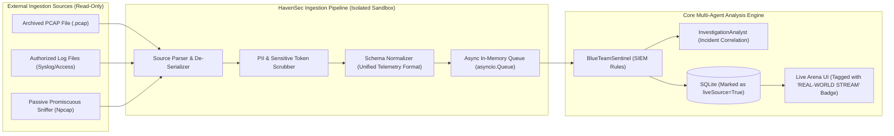

# HavenSec Arena — Safe Live-Monitoring Architecture & Roadmap

**Document Type:** Architectural Design & Future Roadmap Specification (Non-Implemented Design)  
**Document Version:** 1.0.0  
**Project:** HavenSec Arena — AI-Powered Multi-Agent Cyber-Resilience Simulation Platform  
**Academic Context:** Tapi Diploma Engineering College | Department of Information Technology | Semester 5 — Minor Project  
**Student Author:** Heet Kalthiya  

---

## 1. Executive Summary & Design Scope

HavenSec Arena is currently a **100% synthetic, deterministic cybersecurity simulation platform**. All network assets, telemetry events, attack vectors, and containment playbooks are safely modeled in software memory and stored in SQLite.

This document presents the **Safe Live-Monitoring Design Specification** as an optional future enhancement for Semester 6 (Major Project).

> [!IMPORTANT]
> **Safety Boundary & Design Principle**: Live monitoring in this design is strictly **passive, read-only, and disabled by default**. It introduces zero active network scanning, zero packet injection, and zero real-world containment execution. It exists solely to allow the Blue Team Sentinel and Investigation Analyst to evaluate real-world or imported telemetry alongside synthetic benchmarks.

---

## 2. Ingestion Models Comparison

Three architectural models were evaluated for introducing real-world telemetry into HavenSec Arena:

| Dimension | Model 1: Offline PCAP File Ingestion | Model 2: Authorized Log File Ingestion | Model 3: Passive Live Network Capture |
|---|---|---|---|
| **Mechanism** | Upload `.pcap` / `.pcapng` files via REST endpoint; parsed using `scapy` or `pypacker`. | Stream local log files (Nginx, Apache, Windows Event Log, Linux syslog) via tailing reader. | Passive promiscuous packet sniffing via raw sockets or libpcap/Npcap on a designated network interface. |
| **Risk Level** | **Zero Risk** (Completely offline and bounded). | **Very Low Risk** (Read-only filesystem access to configured log paths). | **Moderate Risk** (Requires administrative/root privilege, network visibility concerns). |
| **Reproducibility** | **100% Deterministic** (Same PCAP always produces identical packets and alerts). | **High** (Deterministic replay of archived log lines). | **Non-Deterministic** (Subject to live network timing, jitter, and background traffic). |
| **Platform Dependencies** | None (pure Python binary parsing). | Standard file reading. | Requires Npcap (Windows) or libpcap (Linux) drivers. |
| **Suitability for HavenSec** | **Primary Recommendation (Phase 1)** | **Secondary Recommendation (Phase 2)** | **Optional Research Only (Phase 3)** |

---

## 3. High-Level Ingestion Architecture



---

## 4. Normalization to HavenSec Telemetry Schema

Regardless of input source, every external event must be mapped into the canonical HavenSec `TelemetryEvent` structure:

```json
{
  "id": "tel-live-7b8a1c92",
  "exerciseId": "ex-live-stream-01",
  "timestamp": "2026-10-29T18:30:15.120Z",
  "type": "HTTP_REQUEST",
  "sourceAsset": "WEB-EXTERNAL-01",
  "actor": "203.0.113.88",
  "severity": "medium",
  "phase": "monitoring",
  "data": {
    "uri": "/wp-login.php",
    "method": "POST",
    "statusCode": 401,
    "payloadSnippet": "log=admin&pwd=*** [SCRUBBED]"
  },
  "groundTruthObjectiveId": null,
  "isMalicious": false,
  "isLiveTelemetry": true,
  "ingestionSource": "pcap-import"
}
```

### Safety & Sanitization Rules
1. **PII and Secret Scrubbing**: Passwords, authorization tokens (`Bearer ...`, cookies), and internal domain names are hashed or replaced with `[SCRUBBED]`.
2. **Ground Truth Boundary**: Real-world events do NOT carry `groundTruthObjectiveId`. The Referee scoring engine must detect when an exercise is in `live_monitoring` mode and switch from Ground-Truth Recall to Heuristic Threat Indexing.
3. **Strict Bounded Execution**: The `ResponseCommander` is **strictly inhibited** in live-monitoring mode. Containment actions remain advisory text only; no playbooks are executed against real infrastructure.

---

## 5. UI/UX Distinction and Operator Guardrails

To prevent operator confusion between synthetic drills and real telemetry:
1. **Prominent Banner**: The UI displays a persistent high-contrast banner:
   `[LIVE MONITORING MODE — READ-ONLY TELEMETRY STREAM — CONTAINMENT INHIBITED]`
2. **Distinct Event Badges**: Live events render with a distinct badge: `<span class="badge badge-purple">LIVE INGESTION</span>`.
3. **Containment Button Disablement**: In live mode, all manual containment buttons (`Quarantine Host`, `Revoke Token`) are disabled with a tooltip: *"Manual containment is disabled for live network telemetry."*

---

## 6. Implementation Phasing & Effort Estimation

| Phase | Milestone | Deliverables | Estimated Effort |
|---|---|---|---|
| **Phase 1** | **Offline PCAP Ingestion** | Endpoint `POST /api/exercises/import-pcap`; scapy-based packet decoder; maps TCP/HTTP/DNS into `TelemetryEvent`; replay rate control ($1\times, 5\times, 10\times$). | 2 weeks |
| **Phase 2** | **Structured Log File Tailing** | Background async file watcher for Nginx/Apache logs and JSON audit logs; regex parsers for authentication failures and directory traversals. | 2 weeks |
| **Phase 3** | **Heuristic Referee Scoring for Live Data** | New scoring model that calculates threat density, detection coverage, and alert precision without relying on synthetic ground truth. | 1.5 weeks |
| **Phase 4** | **Optional Passive Sniffer** | Optional Npcap integration for passive packet capture on a designated virtual interface. | 3 weeks |

---

## 7. Recommendation for Minor vs. Major Project

- **Minor Project (Semester 5 — Current)**: Retain the **100% synthetic, deterministic multi-agent platform**. It provides 100% reproducible demonstrations for viva examiners, passes 25 automated unit/integration tests, requires zero device drivers or root permissions, and guarantees zero operational risk.
- **Major Project (Semester 6 — Future)**: Implement **Phase 1 (Offline PCAP Ingestion)** as a modular extension to demonstrate real-world packet inspection while preserving the existing proven multi-agent simulation foundation.
